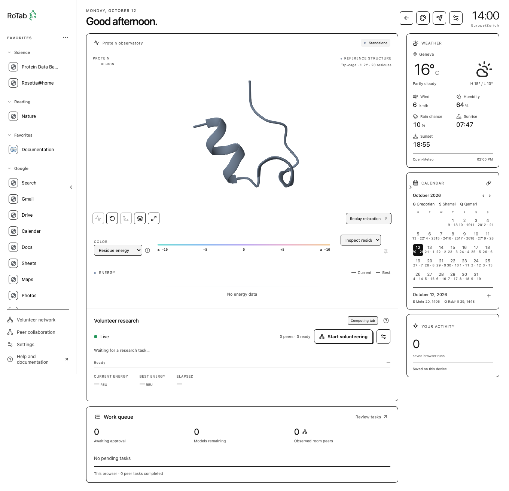
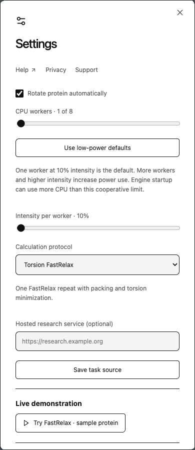
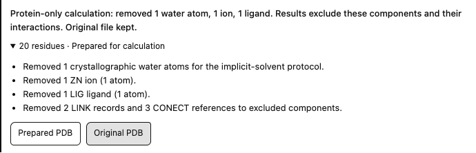
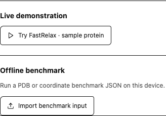

# Protein view and local calculations

Click the protein tile or **Open dashboard** to enter the full view. The dashboard displays the current or reference structure, retained scientific snapshots, color controls, energy history and volunteer setup. Arrows on the left and right panel edges collapse the side panels to enlarge the protein workspace.

{ .help-shot loading=lazy }

## View controls

| Control                           | Effect                                                                                   |
| --------------------------------- | ---------------------------------------------------------------------------------------- |
| Smooth motion                     | Interpolate the display between measured coordinates; does not create scientific samples |
| Reset view                        | Restore camera framing                                                                   |
| Automatic orbit                   | Toggle rotation and save the same preference used in Settings                            |
| Atoms/ribbon                      | Change molecular representation                                                          |
| Fullscreen                        | Enlarge the molecular view                                                               |
| Compare start / selected baseline | Align another retained structure for visual comparison                                   |
| Color / Inspect residue           | Choose coloring and select a residue to inspect available data                           |
| Replay this calculation           | Play retained measured snapshots; does not rerun the protocol                            |

Rotation defaults on. **Computation settings → Rotate protein automatically** saves an off choice across tabs/reloads. Reduced motion disables it, and selecting a residue pauses it for inspection. Hidden/offscreen views skip continuous rendering.

Residue-energy colors require per-residue energy data in the selected structure. Reference/unscored inputs may use neutral colors. Color is a display of the computed metric; it is not an experimental confidence or disease annotation.

## Calculation methods

**Score** evaluates fixed coordinates. Its initial/final snapshots can look identical, and a flat two-point graph does not by itself mean a stopped calculation. **Minimize** or **FastRelax** can produce a changing optimization trajectory. Packing changes side chains; design methods can change sequence. These are bounded methods rather than arbitrary native Rosetta commands. [Method catalogue](../wasm/methods/index.md).

{ .help-shot .help-shot-narrow loading=lazy }

One worker at 10% cooperative intensity is the extension default. Higher worker counts run independent models with separate memory, rather than accelerating a single model through shared cores. The intensity setting controls cooperative work/sleep periods and is not a hardware temperature cap.

## Run a local demo or imported benchmark

Open **Computation settings → Live demonstration → Try FastRelax · sample protein** for the bundled example. Under **Offline benchmark**, upload supported coordinate JSON/PDB/ENT or gzipped PDB data. The importer resolves supported alternate atom locations and ensembles locally and retains preparation provenance. A PDB-only benchmark defaults to Score. Select an optimization protocol for structural refinement.

Uploads are prepared as protein-only inputs. Water, non-protein ions and ligands are removed along with connectivity records that refer to them. A visible caution lists the removals before calculation; expand the input summary for details and **Original PDB** / **Prepared PDB** downloads. The original file is retained. Results exclude the removed components and their interactions, so they describe the protein alone. Modified amino acids, missing backbone atoms and additional protein chains can still require a supported input. [Exact preparation policy](../wasm/io.md#explicit-preparation).

{ .help-shot loading=lazy }

The example uses bundled 20-residue coordinates with added water, zinc and a ligand. Installed Chrome and Brave upload checks confirmed visible cautions and exact original downloads; subsequent WASM Score results passed independent native rescoring. [Validation summary](../assets/evidence/protein-cleanup-browser-proof.json).

{ .help-shot .help-shot-narrow loading=lazy }

There is no protein residue-count admission cap. Browser memory, stack limits, supported chemistry and the engine's database coverage still constrain real inputs. An accepted upload is not a guarantee every method will complete on it. [Large protein memory](../wasm/memory.md).

## Startup, completion and recovery

Cold initialization can take minutes before the first measured snapshot. The worker loads and initializes Rosetta, then prepares and scores the structure. This stage can produce CPU bursts before cooperative throttling starts. Extension workers are recreated per model, so setup can recur. Comparative measurements have not established the cause of differing temperature and fan behavior across users' Macs.

Pause/stop an active calculation to terminate its worker. Completed models are saved. Resuming an unfinished model replays its original seed rather than continuing a full in-memory checkpoint. **Pause new tasks** concerns future volunteer assignments and can let the current model finish.

Workers are also terminated on completion. Saved structures, the molecular viewer and browser caches still occupy memory afterward. **WASM heap** reports active workers' linear memory, while **UI JS heap** reports the page's approximate JavaScript allocation; neither is the tab's total RAM. [Memory lifetime and measured checks](../wasm/memory.md#completion-and-retained-memory).

The computing tab displays a notice while a calculation is starting or running. Attempting to close, reload or leave that tab requests the browser's confirmation; canceling keeps the calculation running. Linked tabs and paused, completed, stopped or failed runs do not request this warning. Confirming departure terminates the tab's workers; another open tab may recover saved work by replaying unfinished seeds. Browsers supply the confirmation wording and require prior interaction with the page to display it. [Browser close-warning behavior](https://developer.mozilla.org/en-US/docs/Web/API/Window/beforeunload_event).

The energy graph supports selecting retained measured structures and comparing them against a pinned baseline. Frame storage is bounded, so large PDBs may retain fewer structures than energy samples. The final PDB download and **Export run records** provide coordinates, seeds, hashes, histories and retained frames. Review exported content before sharing. Local benchmark data remains local unless explicitly submitted or shared through another workflow.
