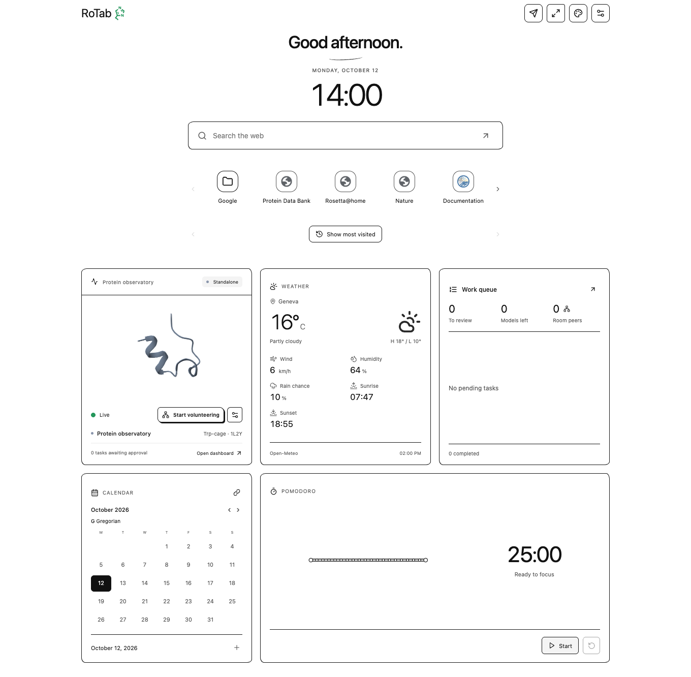

# Help

RoTab opens in Simple view by default. The protein tile opens the detailed dashboard; the back arrow returns to Simple view. Appearance stores the preferred opening layout independently of the view open in another tab.

{ .help-shot loading=lazy }

## Find a control

| Action | Control or guide |
| --- | --- |
| Change theme, background, opening layout or search suggestions | Palette icon → [Appearance](personalization.md#appearance-and-search) |
| Add/remove favorites, folders or shortcut rows | Hover/focus the favorite bar → [Shortcut controls](personalization.md#favorites-and-folders) |
| Change calendars, move/resize/hide a widget | Widget's upper controls → [Personal widgets](personalization.md#widgets-and-calendars) |
| Set focus duration or start a Pomodoro | Click the timer's digits → [Focus timer](personalization.md#folding-pomodoro) |
| Start helping with research | Dashboard → [Start volunteering](volunteering.md) |
| Submit a protein for volunteer calculation | Paper-plane icon → [Submit a target](volunteering.md#submit-a-target) |
| Rotate the molecule, inspect energy or run a local demo | [Protein and calculations](calculations.md) |
| Resolve a failed connection, missing result or memory error | [Troubleshooting](troubleshooting.md) |
| Set up a managed TURN relay for different networks | [Connect across networks](turn.md) |

**OK** closes a menu or confirms its form. Many settings apply immediately; Calendar settings apply on confirmation. Escape or X dismisses the menu. Submitting a scientific job, pausing new assignments and stopping an active calculation each use separate controls.

## Status indicator

| Histidine color | Meaning |
| --- | --- |
| Green | Network connection is live; no model is currently computing |
| Pulsing green | Research/volunteer computation is active |
| Yellow | Local benchmark or demo is active |
| Gray | Idle without a live network connection |
| Red | An error needs attention |

The computing tab's favicon uses these states; linked tabs keep a neutral Histidine outline. The Histidine beside **RoTab** shows the shared status in either view. Reduced motion disables the pulsing effect. A linked tab offers **Go to main tab** for owner-only settings. Opening additional RoTabs in the same profile does not create extra independent volunteers.

## Illustrations

Screenshots use isolated browser profiles, the bundled Trp-cage reference, example weather, and controlled network fixtures. They illustrate controls and do not represent a public research campaign or establish reachability between different networks.

[Data and privacy](../policies/privacy.md) describes recipients and local storage. [Architecture](../architecture.md) explains the implementation.

## Open Help from RoTab

RoTab 0.5.6 provides **Help**, **Privacy** and **Support** links in Appearance and Settings. The dashboard sidebar also provides **Help and documentation**. These links open this website in a separate browser tab; the website does not supply executable code to the extension.
