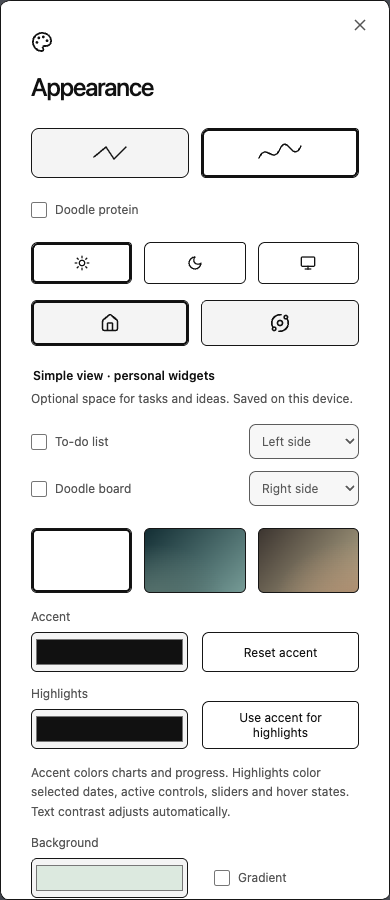
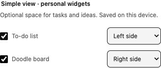
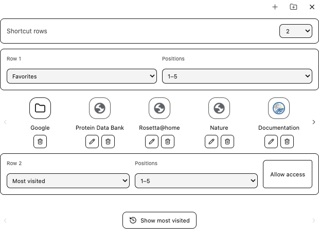
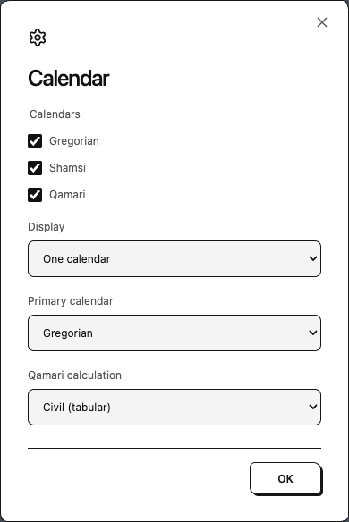
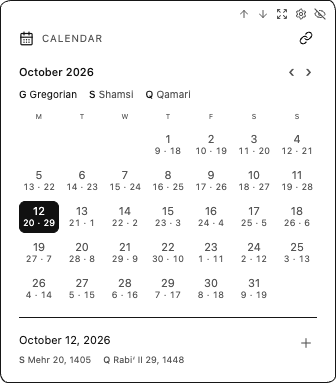
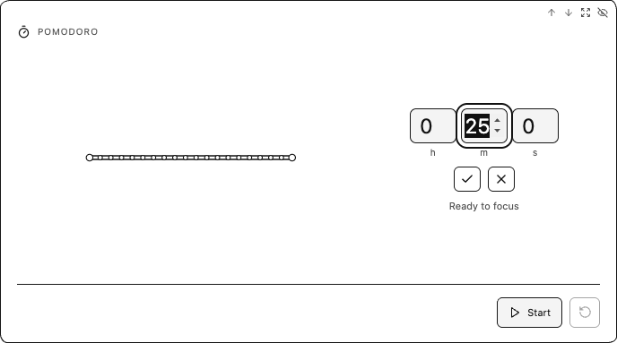

# Appearance, favorites and widgets

## Appearance and search

Open the palette icon in the upper navigation. Choose Doodle or Observatory, Light/Dark/System, a font, accent and highlight colors, background or local background image. Fresh installations use white Doodle and Simple view. The opening-layout option controls future new tabs; using Dashboard temporarily in one tab does not change the saved choice.

**Accent** controls charts, progress and interface accents. **Highlights** independently controls selected dates, active controls, sliders, hover states and text selection. Highlight colors follow the accent until a separate color is chosen. **Use accent for highlights** restores that link; **Reset accent** leaves a separately chosen highlight intact. Colors and foreground text adapt to the current theme for contrast, and both preferences are saved across tabs and reloads.

{ .help-shot .help-shot-narrow loading=lazy }

**Google search suggestions** enables completion while typing. It defaults off. When on, partial queries are sent to Google; submitting a search also opens Google. This option is search completion, not advertisements. Uploaded backgrounds are stored locally; volunteer peers do not receive them.

## Optional to-do list and doodle board

In the palette menu, under **Simple view · personal widgets**, enable **To-do list** or **Doodle board** and choose **Left side**, **Middle** or **Right side** for each. Both default off, including on upgrades. They appear only in Simple view.

The greeting, search and central widget grid stay centered regardless of which side is occupied. Side tools use the available gutter width and window height; two tools on the same side share that height equally. On narrower windows, side tools move below the main content instead of covering it. **Middle** uses the compact card format in the central grid, with the same move-earlier/later and resize controls as other widgets.

The arrows and middle-placement icon move a personal widget between these locations. Hover a middle card, or focus it with the keyboard, to reveal its controls. The eye control hides the widget while keeping its contents; enable it again in the palette menu to restore it.

The to-do list supports adding tasks with Enter or **+**, checking tasks off, deleting individual tasks and **Clear completed**. The doodle board provides pen colors, an eraser that removes whole strokes, **Undo last stroke**, movable text notes and a larger editing view. **Clear board** asks for confirmation before removing drawings and notes. The drawing sheet scrolls vertically, providing additional space in both tall side tools and compact middle cards. Drawings and note proportions are preserved between placements. The board is a bounded scratch space rather than a full infinite-canvas application.

Tasks, strokes and notes save locally in the browser profile and update across its open RoTab tabs. **Saving…** changes to **Saved locally** when a write completes; allow it to finish before closing or reloading. Contents are not sent to volunteer peers or included in scientific experiment exports. Clearing extension/site data removes them. There is no cloud synchronization or account requirement.

{ .help-shot .help-shot-narrow loading=lazy }

The controls are shown in an isolated browser profile. [Validation summary](../assets/evidence/personal-widgets-browser-proof.json).

## Favorites and folders

Hover the favorite bar, or focus its controls with the keyboard, to reveal **Add shortcut**, **Create favorite folder** and **Configure shortcut rows**. Between zero and three rows can be configured. Each row can display favorites, a folder/group or browser most-visited sites. Most-visited rows require optional browser permission. An unavailable or empty list leaves the row empty.

{ .help-shot loading=lazy }

The default Google folder opens nine Google services, with a back tile returning to the main favorites. Folder controls support creating folders, adding existing links, reordering members, removing links and removing a folder while keeping its links. The Google folder uses the same editing and removal controls. Favorite tiles can be edited or deleted directly in Simple view.

The initial favorite row includes the Google folder and bundled science/reading/personal links; the next row defaults to most visited. Favicons keep their proportions inside the tile. Browser-provided site icons or bundled icons are used where available, with initials as fallback.

## Widgets and calendars

Reveal a widget's upper controls to move it earlier/later, resize it or hide it. The protein tile stays the anchor in Simple view; the remaining tiles reflow on a shared size grid. Dashboard side arrows collapse/reveal the favorites sidebar and the widgets panel to give the protein more space. **Computation settings → Restore widgets** brings hidden widgets back.

The Calendar gear sits beside its move/resize/hide controls. It opens that calendar's own settings:

{ .help-shot .help-shot-narrow loading=lazy }

Choose Gregorian, Shamsi, Qamari or a combination. **One calendar** uses a primary calendar grid with compact secondary dates; **Separate widgets** gives each enabled system its own tile. For a combined grid, choose the primary system. Qamari calculation selects the available civil/Umm al-Qura calculation; regional observation can differ from a computed date.

{ .help-shot .help-shot-narrow loading=lazy }

Use the month arrows to navigate, select a day and use **+** to add a local event. Local events remain in the browser profile. The Calendar connection icon opens optional Google Calendar setup, which requires a configured OAuth client and separate authorization. Local calendars and events require no Google connection. [Privacy and Calendar data](../policies/privacy.md).

## Weather

Weather attempts device location with browser/OS permission and displays the city when resolved, for example **Current location - Geneva**. If lookup fails or permission is denied, the widget offers city entry. Click the location to change it or retry device location. Each browser profile stores its own choice; there is no preset city.

The smaller weather tile shows available daily details such as wind, humidity, rain chance and sunrise/sunset. Expanding adds the forecast with the selected day range. Unavailable provider fields are omitted. Weather requests go to Open-Meteo and reverse city lookup to Photon/Komoot; this feature is separate from volunteer research.

## Folding Pomodoro

Click minutes/seconds on the countdown to edit the duration in place. The editor also exposes hours; zero hours are hidden in the normal countdown. Save the duration, then start. Pause retains remaining time; reset restores the configured session duration.

{ .help-shot loading=lazy }

The chain graphic becomes more folded as the timer advances. It is a focus illustration, not a live Rosetta calculation. Completion plays a synthesized ding when the browser permits audio, and a progress ring can appear on the tab icon. Muted tabs, browser audio policy or closing every RoTab can prevent sound. Timer state is separate from submitted proteins and scientific contribution counts.
