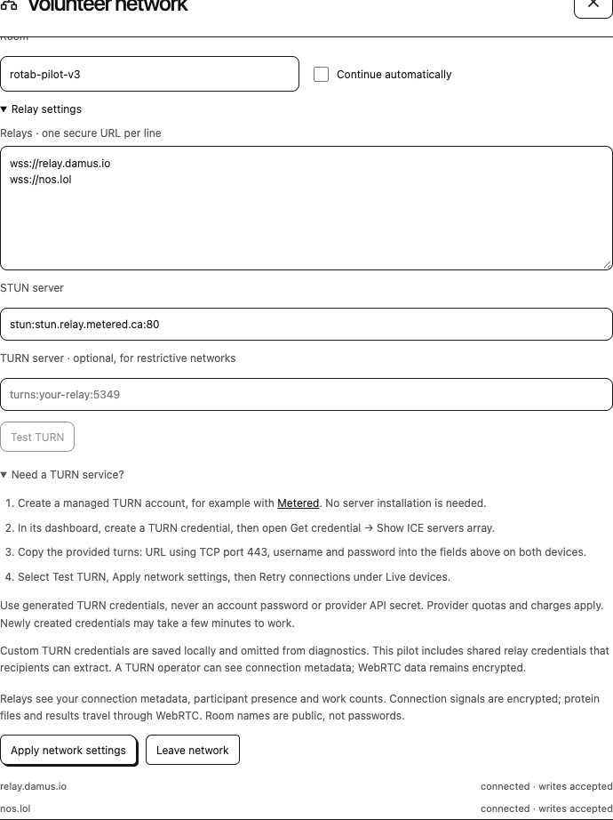

# Connect across networks

Nostr discovery and WebRTC data transfer are separate stages. A peer can appear online before the browsers have a usable route for assignments and results.

| Service | Role |
| --- | --- |
| Nostr relay | Discover participants and exchange encrypted connection signals |
| STUN | Discover candidate network addresses |
| TURN | Relay encrypted WebRTC traffic when direct connectivity is unavailable |

TURN does not run Rosetta or coordinate campaigns. Scientific transfers use a direct route when one is available.

## Shared pilot access

The shared-TURN 0.5.2 private pilot includes generated relay access for profiles without an existing TURN configuration. Volunteers do not need separate provider accounts or manual authentication entry. Custom TURN settings and explicit network opt-outs remain saved.

1. Use compatible RoTab builds and the same room, normally `rotab-pilot-v3`.
2. If discovery is disabled, select **Join Nostr network** in Connection settings.
3. Select **Start volunteering** for future compatible work, or **Contribute** for one offered model.
4. Check **Live devices**, then verify assignment, progress, and return of one model.

The submitting browser's main tab coordinates its campaigns and must remain available for assignment and receipts. A volunteer's computing tab must remain open while its model runs.

Shared relay access is readable from the extension build and uses the operator's provider allowance. Expiry, revocation, or quota exhaustion can interrupt fallback connectivity. Custom authentication remains local to the browser profile. The pilot uses the Free-tier `standard.relay.metered.ca` service over TLS/TCP port 443; the standard source build supplies no shared access.

## Campaign authority

Any compatible connected participant can submit a target or volunteer. Relay account ownership does not confer an exclusive publishing role. Each sender owns its own campaign ledger, and the room name is a public discovery topic rather than a password.

**Also calculate on this browser** allows the sender to contribute models through the same queue. [Volunteering and submission](volunteering.md).

## Custom TURN settings

A managed service provides TURN without a participant-side server. Custom access requires settings issued by that provider. RoTab is not affiliated with a TURN provider.

In **Volunteer settings → Connection settings → Relay settings**, enter the issued TURN endpoint and authentication in their respective fields. RoTab currently accepts one TURN URL; a provider's ICE array can list several alternatives. A TLS-over-TCP `turns:` endpoint on port 443 can be useful on restrictive networks. [Provider transport reference](https://www.metered.ca/docs/turn-server-service/quickstart/).

Select **Test TURN** on each device. After a successful allocation, select **Apply network settings**, then **Retry connections**. A one-model exchange is needed to confirm the complete path between the participants.

Generated relay access is separate from an account password or provider management secret. Provider changes can require updated endpoints and authentication on each affected profile. Previously applied settings are preserved during an extension upgrade. Clearing **TURN server** and applying the change disables fallback; the empty setting persists after reload.

## Monthly allowance and availability

Provider information checked October 13, 2026: Metered's Open Relay advertises 20 GB of free TURN traffic each month. The allowance is shared by all devices using one operator account; it is not a separate allowance for each volunteer. [Open Relay description](https://www.metered.ca/tools/openrelay/).

The provider counts incoming and outgoing relay bytes. Included usage resets each billing period and does not carry over. Free plans can change or be withdrawn and have no service-level or support guarantee. [Provider terms, section 7 and Schedule 1](https://www.metered.ca/terms).

Quota exhaustion and outages can interrupt relayed transfers while discovery remains visible. Local calculation and working direct routes can continue without TURN. RoTab does not automatically purchase service or provision replacement access.

## Test results

{ .help-shot loading=lazy }

The illustration uses empty authentication fields in an isolated profile. It shows the controls, not a successful connection between different networks.

| Result | Meaning |
| --- | --- |
| TURN relay available | This device allocated a relay candidate. Peer connection and job delivery remain separate checks. |
| No relay candidate | The endpoint, authentication, provider limits, propagation, or allowed transport need review. |
| Reply received; checking connection | Setup is still in progress. |
| Connection checks failed | This attempt found no usable route. |
| Waiting for reply | The setup exchange has not produced a remote description. |

The test creates a temporary relay-only WebRTC connection without a peer or scientific worker. It closes on completion, cancellation, or after twenty seconds. Closing the menu or editing the tested settings cancels it.

## Diagnostics

**Download connection diagnostics** records setup state, ICE/transport state, candidate types, numeric server errors, and up to four previous attempts per observed peer. Its in-memory history clears on reconfiguration, peer expiry, or reload.

`host` identifies a local candidate, `srflx` an address discovered through STUN, and `relay` a TURN allocation. A discovered external address does not establish reachability from another network. The report excludes addresses, raw SDP, identities, authentication values, and scientific data. Experiment exports are separate and can contain research data.

## Validation scope

Recorded Chrome and Brave tests established relay allocation and encrypted message/reply transfer over TLS. The shared pilot also returned four WASM minimization models per browser family, with all eight outputs passing independent native rescoring. These tests used isolated profiles on one computer. Different-network reachability and comparative thermal behavior remain unestablished. [Benchmark interpretation](../benchmarks.md), [connection architecture](../extension/connections.md), [validation summaries](../evidence.md).
