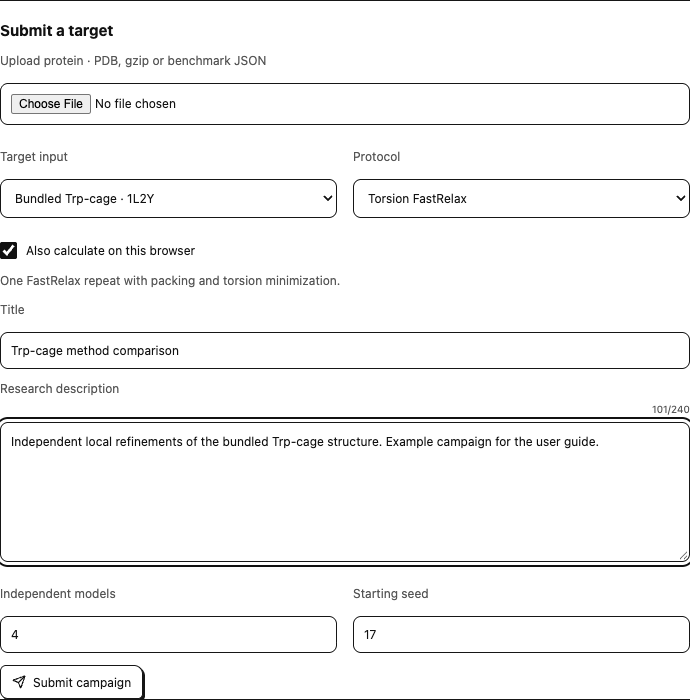
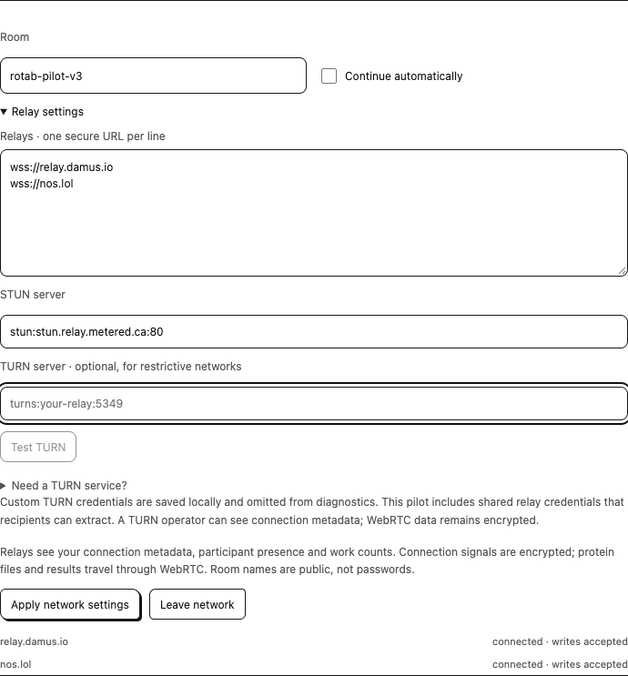
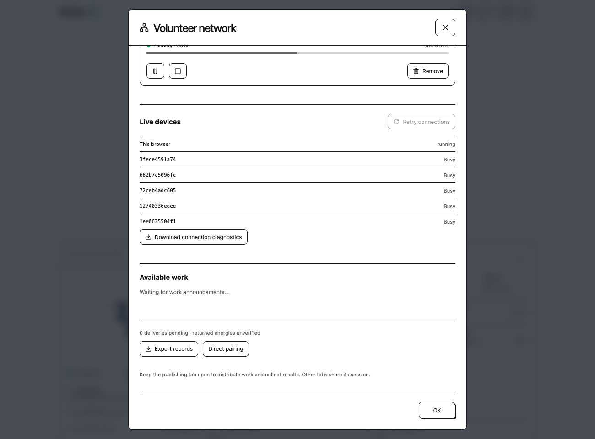

# Volunteer or submit a protein

## Start volunteering

Open the dashboard and select **Start volunteering**. This enables compatible future assignments under the saved local CPU budget. The standard workflow requires no relay-setting changes. Discovery starts by default; calculation requires explicit volunteering or acceptance of a specific model.

**Pause new tasks** stops new acceptance while an active model can finish. **Contribute** on an available campaign accepts one model without opting into all later work. The assigned protein, sender's short description and measured energy/snapshot data appear in the volunteer dashboard.

The **Work queue** widget summarizes tasks to review, remaining models, observed peers and completed work. Its counts are local observations, not worldwide volunteer totals. A connected green mark is distinct from actual computation/progress. Multiple tabs in one browser profile share one worker owner; different profiles/devices can be separate volunteers.

## Submit a target

Submission is available to compatible connected participants, including volunteers using the pilot's shared TURN access. It is not restricted to the relay account owner. Each sender coordinates its own campaigns; an approved-sender restriction is not implemented.

Use the paper-plane **Publish a target** control or the Volunteer network menu. Upload a supported target, choose a fixed method, title, required short research description, number of independent models and starting seed. Keep the description concise: it is limited to 240 characters and shown to volunteers.

The uploader prepares a protein-only copy and shows a caution when water, ions or ligands are removed. Expand its summary to review removals or download the original and prepared files. Volunteers calculate the prepared protein; the excluded components' effects are not included. Modified protein residues are not silently discarded. [Input preparation details](../wasm/io.md#explicit-preparation).

{ .help-shot loading=lazy }

**Also calculate on this browser** is checked by default, allowing the submitting browser to participate through the same assignment and result-delivery path as remote volunteers. Submit after preparing the target and settings. The submitting browser must remain available to assign work and receive results. Submitted targets are shared with connected volunteers; only authorized research and data may be submitted.

The model count requests independent runs with distinct seeds, not pieces of one large protein. If four models are requested and six eligible devices are present, all six cannot receive one simultaneously. Compatible version, active consent, a working direct connection and availability also affect assignment. The campaign's activity view shows assignment/loading/running, reported energy/progress, stale updates and received results.

Under **Your campaigns**, click a campaign's title or summary to expand its research description, structure size, seeds, worker activity and scientific provenance. Input files, individual completed models and campaign records are available for download; larger model lists have page controls. **Remove** requires confirmation before deleting the campaign and its locally saved campaign results and withdrawing new assignments. Models already running may finish, but their late returns are discarded and acknowledged as obsolete. Export required records before removal. Copies in other browsers and separate local run records remain unaffected.

## Connection settings when needed

Open **Volunteer settings → Connection settings**. Devices need the same compatible build/wire version and room with reachable relay discovery. Default room is `rotab-pilot-v3`. Under **Relay settings**, inspect exact per-relay errors and optionally configure secure relay/STUN/TURN details.

{ .help-shot loading=lazy }

{ .help-shot loading=lazy }

The Live devices illustration uses a controlled six-profile connection fixture. It shows status controls rather than a public volunteer campaign.

**Live devices** shows whether RoTab is finding a route, waiting for the peer's reply or checking a connection. **Retry connections** retries disconnected peers while preserving working sessions and saved work. **Download connection diagnostics** exports setup state and route types without addresses, keys, credentials or protein/job data.

A failed relay is isolated; another healthy relay or existing direct connection may still work. A relay connection cannot guarantee WebRTC reachability. TURN can help restrictive networks. The shared-TURN private pilot installs generated relay access automatically where TURN is absent; volunteers need no provider account or manual credential entry. Custom services can still be configured. **Need a TURN service?** inside Relay settings provides a managed setup option. **Test TURN** checks allocation without running science; apply the settings before retrying a peer connection. Follow the [cross-network setup guide](turn.md) for steps and test limits. **Direct pairing** remains an advanced manual invitation/reply alternative.

## Results and privacy

A worker retains a completed signed result until it gets a matching publisher receipt. If the publisher is offline, delivery can retry when the same session identity/database returns. **Received** means the matching result was saved, not independently rescored or credited by Rosetta@home. Reassigned/cancelled attempts can make a delayed result obsolete.

Public relays receive presence and encrypted connection signals. Protein files, returned coordinates and descriptions travel directly to connected participants rather than as public Nostr content. Participants can retain data they receive. Read the [data and privacy reference](../policies/privacy.md), [connection architecture](../extension/connections.md) and [assignment architecture](../extension/jobs.md) for exact boundaries.
